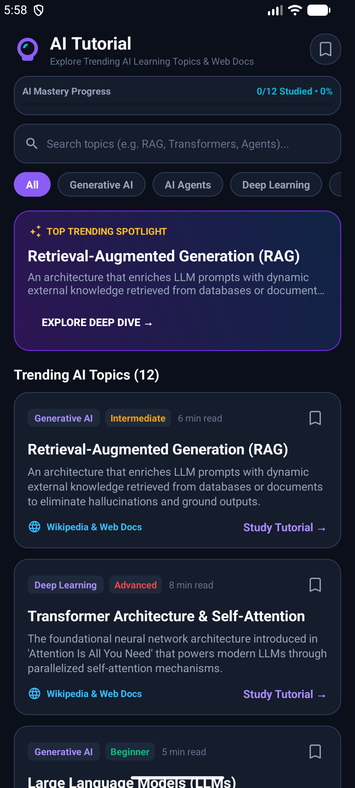

# AI LearnHub - Trending AI Topics & Tutorials App

An interactive Android learning app built in **Kotlin** and **Material Design 3** that aggregates trending Artificial Intelligence topics and live knowledge directly from **Wikipedia** and authoritative educational sources.



---

## 🚀 Key Features

- **🧠 Trending AI Learning Topics**: Curated list of cutting-edge AI domains (Generative AI, LLMs, Transformer Architecture, Reinforcement Learning, Neural Networks, Computer Vision, etc.).
- **🌐 Live Wikipedia Integration**: Fetches real-time encyclopedia summaries, references, and deep-dive learning links via Wikipedia REST APIs.
- **📚 Rich Topic Detail Screen**: Dedicated view with concept overviews, real-world applications, prerequisites, and learning paths.
- **🔍 Instant Topic Search**: Fast filtering to find specific machine learning concepts and frameworks.
- **🎨 Material 3 Theming**: Modern card layouts, topic badges, and responsive UI.

---

## 🛠️ Tech Stack

- **Language**: Kotlin
- **Build System**: Gradle Kotlin DSL
- **Compile SDK**: 36.1 | **Min SDK**: 24
- **Networking**: Kotlin Coroutines & `HttpURLConnection` for live Wikipedia REST queries
- **UI Architecture**: ViewBinding, RecyclerView, Material 3 Design Tokens

---

## 📦 How to Build & Run

```bash
# Clone the repository
git clone https://github.com/rajeevksofficial/AITutorialApp.git
cd AITutorialApp

# Build Debug APK
./gradlew assembleDebug
```

---

## 📄 License
Open source under the [MIT License](LICENSE).
